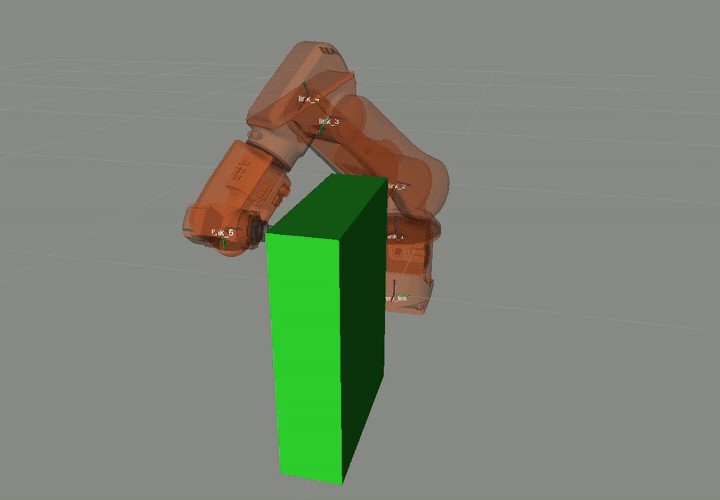
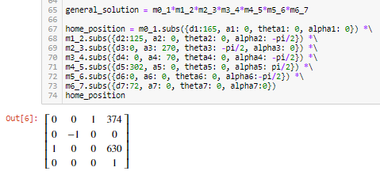
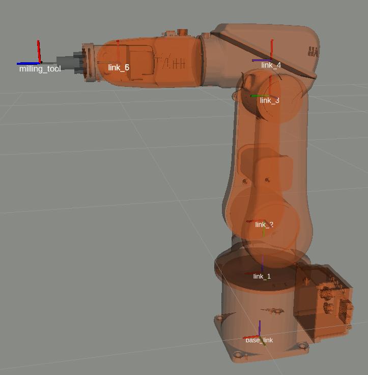
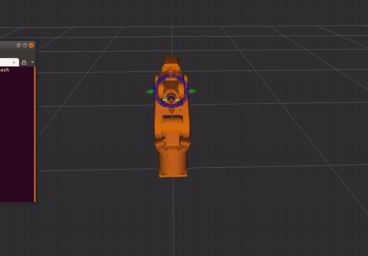
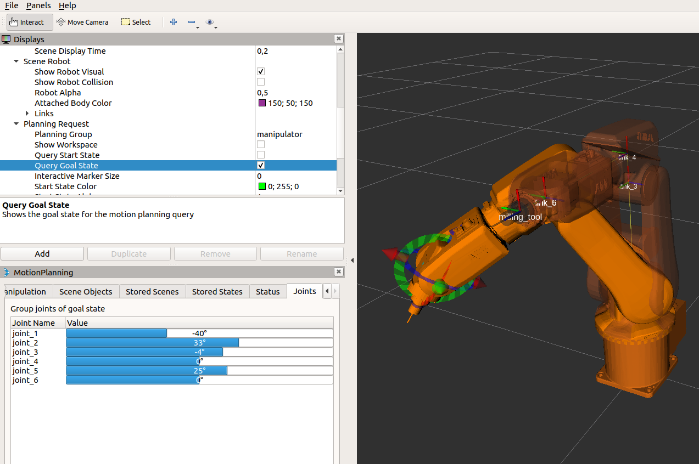

# ABB IRB 120 for Milling: Kinematics and MoveIt Motion Planning



*MoveIt plans and runs four drilling poses with the ABB IRB 120 and a milling spindle in RViz, while avoiding a box in the planning scene.*

Course project for **Industrial Robotics** (MSc Mechatronics/Robotics, FH Technikum Wien, winter term 2020).
I set the 6-DOF ABB IRB 120 up as a machining robot:

1. I mounted a milling spindle on the flange.
2. I derived the forward kinematics with Denavit–Hartenberg (DH) parameters in SymPy.
3. I extended the robot's URDF with the tool.
4. I generated a MoveIt configuration.
5. I wrote a Python node that moves the tool tip to Cartesian drilling poses. MoveIt solves the inverse kinematics and plans paths around obstacles.

## Forward kinematics (DH)

[`kinematics/forward_kinematics.ipynb`](kinematics/forward_kinematics.ipynb) builds one standard DH matrix per joint:

```
A_i = Rot_z(θi) · Trans_z(di) · Trans_x(ai) · Rot_x(αi)
```

It chains seven frames (6 joints plus the tool point P7) in SymPy. Multiplying the symbolic matrices first gives a huge expression. The notebook therefore puts in the numeric DH parameters *before* it multiplies the matrices, and then evaluates the home pose:

| i | dᵢ [mm] | aᵢ [mm] | θᵢ (home) | αᵢ |
|---|--------:|--------:|:---------:|:---:|
| 1 | 165 | 0   | θ1        | 0    |
| 2 | 125 | 0   | θ2        | −90° |
| 3 | 0   | 270 | θ3 − 90°  | 0    |
| 4 | 0   | 70  | θ4        | −90° |
| 5 | 302 | 0   | θ5        | +90° |
| 6 | 0   | 0   | θ6        | −90° |
| 7 (tool) | 72 | 0 | –       | 0    |

The link lengths come from the IRB 120 dimension drawing (165 + 125 = 290 mm up to axis 2, 270 mm upper arm, 70 + 302 mm forearm, 72 mm flange).



## Robot model and MoveIt pipeline

 

```
irb120_support/         URDF (irb120t_3_58) + meshes, with an added milling_tool link
irb120_moveit/          MoveIt Setup Assistant package (planning group "manipulator", OMPL, KDL IK)
irb120_python_planner/  planner.py – moveit_commander node with pose goals
kinematics/             SymPy DH forward kinematics (notebook + script)
```

What `planner.py` does:

1. It adds a 0.3 × 0.1 × 0.4 m box as a collision object.
2. It moves the tool to four poses (±0.2 m in y, x = 0.2 m and 0.4 m, z = 0.3 m), with the spindle tilted ±90° about x.
3. For each pose it calls `set_pose_target` and `go`. MoveIt's KDL plugin solves the IK, and OMPL plans a path that avoids the collision.



## How to run

ROS 1 with MoveIt. The code is Python 2 (`print` statements), so use Melodic or older.

```bash
mkdir -p ~/catkin_irb/src && cd ~/catkin_irb/src
git clone https://github.com/Abdulhamid-Baghdadi/irb120-milling-robot-ros.git .
cd .. && catkin build   # or catkin_make
source devel/setup.bash
roslaunch irb120_moveit demo.launch                     # RViz + fake controllers
rosrun irb120_python_planner planner.py                 # in a second terminal
```

To view the forward kinematics, run `jupyter notebook kinematics/forward_kinematics.ipynb`. It needs `sympy`.

## What I built (and what I didn't)

| Part | Origin |
|---|---|
| Forward kinematics notebook/script, DH table | **My own work** |
| Milling tool link + joint in the URDF, tool meshes (`milling_tool*.STL/.dae`) | **My own work** (CAD in SolidWorks) |
| `planner.py` scene setup, drilling poses and tool orientation | **My own work**, written on top of the MoveIt tutorial skeleton (see below) |
| `planner.py` structure, `all_close()`, the tutorial comments | MoveIt *Move Group Python Interface* tutorial (moveit_tutorials, BSD-3-Clause) |
| `irb120_moveit/` | **Generated** by the MoveIt Setup Assistant. I chose the planning group and end effector. The rest is boilerplate. |
| `irb120_support/` URDF base and link meshes (`base_link` … `link_6`) | ROS-Industrial `abb_irb120_support` (Apache-2.0, authors: M. Culleton, K. Kelly (TCD), L. Armstrong (SwRI)). The upstream `package.xml` is kept unchanged. |

This is a student exercise from 2020. It has been tested only in simulation (fake controllers) and never on a real robot.

## Credits and licences

- **ROS-Industrial** – [`abb_experimental` / `abb_irb120_support`](https://github.com/ros-industrial/abb_experimental), Apache License 2.0. Meshes and the base URDF in `irb120_support/` come from there. I added the milling tool.
- **MoveIt** – [moveit_tutorials](https://github.com/ros-planning/moveit_tutorials), BSD 3-Clause. `planner.py` is derived from the Python interface tutorial.
- The ABB CAD data, datasheet and lecture material are **not** included. "ABB" and "IRB 120" are trademarks of ABB.
- My own code is MIT-licensed (see [LICENSE](LICENSE)). Third-party files keep their original licences.
